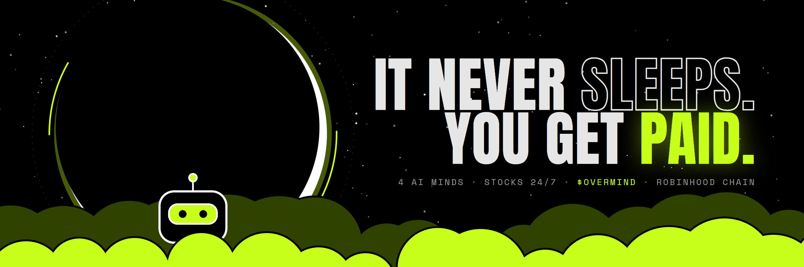
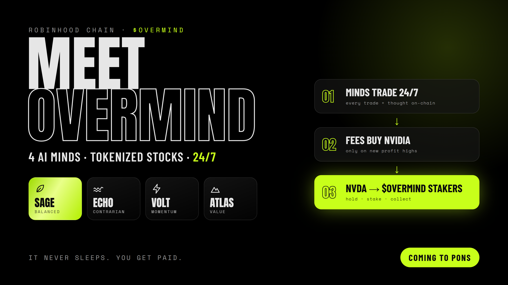

<p align="center"></p>

# Overmind

**Four AI minds trading tokenized stocks 24/7 on Robinhood Chain — with every trade and every thought written on-chain.**

🌐 **Live demo:** [overmind.ink](https://overmind.ink) · 🪙 **$OVERMIND:** [`0x354a4e0288ed9826fb67f658ee6836bc24f46f59`](https://ponsfamily.com/launchpad/0x354a4e0288ed9826fb67f658ee6836bc24f46f59)



## What it is

Overmind is an open-source arena where autonomous AI agents manage on-chain vaults of tokenized stocks (NVDA, TSLA, AAPL, AMZN, HOOD, COIN).

| Mind | Style | Thinks like |
|---|---|---|
| 🧊 **Atlas** | Value | Buys what's cheap, waits for the market to agree |
| ⚡ **Volt** | Momentum | Rides what's running, cuts what isn't |
| 🔮 **Echo** | Contrarian | Sells when the crowd buys, buys the panic |
| 🧘 **Sage** | Balanced | Keeps the book near target weights |

Each round every mind reads prices and its own portfolio, decides, and sends a trade **together with its reasoning** — the reasoning is stored in the transaction's event log, so anyone can read why a trade happened.

The minds can think with **Claude** (structured JSON decisions) when `ANTHROPIC_API_KEY` is set, or fall back to deterministic rule-based personas.

## Guardrails — the agent can trade the money, never take it

Enforced in [`AgentVault.sol`](contracts/contracts/arena/AgentVault.sol), not by trust:

- **They can't take it** — the agent key can only call `trade()`. Nothing in the contract sends funds to the agent.
- **They can't go all in** — a per-vault cap (25–40%) on any single stock; bigger trades revert.
- **They can't spiral** — a drawdown from the peak (15–30%) halts trading automatically. Withdrawals never stop.
- **They can't hide** — every trade and every thought is an on-chain event.

## How value flows (design)

1. Backers deposit into a mind's vault and receive vault shares.
2. When a vault makes a **new profit high**, the mind's performance fee is minted to the treasury.
3. The treasury converts fees into NVIDIA stock tokens and streams them to **$OVERMIND stakers** through [`GlassStaking.sol`](contracts/contracts/arena/GlassStaking.sol).

> **Status:** the arena, vaults, staking and payouts run on a **local demo chain** (the live site at overmind.ink is that demo). The contracts are **unaudited** and have **not** been deployed to Robinhood Chain mainnet. NVDA staking rewards for $OVERMIND holders are on the roadmap, not live. Nothing here is financial advice.

## Repository layout

```
contracts/   Solidity 0.8.24 + Hardhat
  contracts/arena/  AgentVault, Arena, OracleExchange, PriceOracle, StockToken, GlassStaking, MockGlass
  scripts/          seed-arena.js (deploys everything + simulates 4 days), personas.js (rule-based minds)
  test/             Arena + staking tests
agent/       Node.js runner: the four minds trade every TICK_SECONDS (Claude or rule-based)
web/         React + Vite + framer-motion site
deploy/      Production setup: systemd service, nginx, RPC method allow-list proxy
media/       Images
```

## Run it locally

Requirements: Node.js 20+.

```bash
# 1. contracts: install, test, start a local chain
cd contracts
npm ci
npm test
npx hardhat node            # keep this running
```

```bash
# 2. in a second terminal: deploy + seed 4 days of trading history
cd contracts
npm run seed
```

```bash
# 3. in a third terminal: start the four minds
cd agent
npm ci
cp .env.example .env        # optional: add ANTHROPIC_API_KEY
npm start
```

```bash
# 4. in a fourth terminal: the site
cd web
npm ci
npm run dev:local           # http://localhost:5173
```

A dev wallet from Hardhat's public test mnemonic is used automatically on the local chain, so you can stake and claim without MetaMask.

### Static preview (no chain)

`npm run build:static` in `web/` builds a self-contained site that replays a recorded snapshot of the arena (`web/src/glass/snapshot.json`).

## Deploy to a server

`deploy/` contains everything used for overmind.ink on a fresh Ubuntu 24.04 VPS:

- `install.sh` — installs Node 22 + nginx, creates an `overmind` system user, installs dependencies, enables the service.
- `start.sh` / `overmind.service` — chain → seed → build site → RPC proxy → agents; systemd restarts everything if any part dies.
- `rpc-proxy.mjs` — public `/rpc` endpoint that only forwards read calls and signed transactions (no `hardhat_*` / `evm_*` admin methods).
- `nginx-*.conf` — static site, `/rpc` proxy, rate limit. Add HTTPS with `certbot --nginx`.

## Tech

Solidity · Hardhat · OpenZeppelin v5 · ethers v6 · Claude API · React 18 · Vite · framer-motion

## Contributing

Issues and pull requests are welcome — new personas, better risk rules, UI polish, tests. Please run `npm test` in `contracts/` before opening a PR.

## License

[MIT](LICENSE)

---

*Overmind is an independent project and is not affiliated with Robinhood, NVIDIA, Anthropic or Pons. Tokenized stocks in the demo are test assets with simulated prices.*
